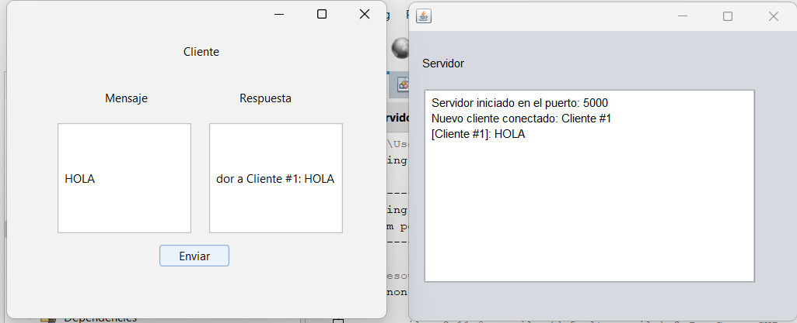

# Servidor de eco multicliente con sockets e interfaz gráfica en Java

Aplicación cliente-servidor en Java donde varios clientes se conectan por sockets TCP al puerto 5000 de un servidor que los atiende a la vez con un pool fijo de 10 hilos. Cuando un cliente se conecta, el servidor le da la bienvenida con su número, según el orden en que se conectó. Después, el servidor regresa cada mensaje que le manda el cliente como eco, y cierra la conexión cuando el cliente escribe "cerrar". El cliente tiene una interfaz gráfica con dos campos de texto: uno para el mensaje del cliente y otro para la respuesta del servidor.

## Tecnologías

Java 22 · Maven · Sockets TCP (`ServerSocket`, `Socket`) · `ExecutorService` · Swing + FlatLaf

## Cómo ejecutarlo

1. Clona el repositorio y compílalo con `mvn compile`.
2. Ejecuta primero el servidor (`mx.unison.javacosas_gui.eco.Servidor`).
3. Ejecuta uno o varios clientes (`mx.unison.javacosas_gui.eco.Cliente_gui`).
4. Escribe un mensaje y presiona **Enviar**. Escribe `cerrar` para terminar la conexión.

Por defecto el cliente se conecta a `127.0.0.1:5000`.

## Imágenes

